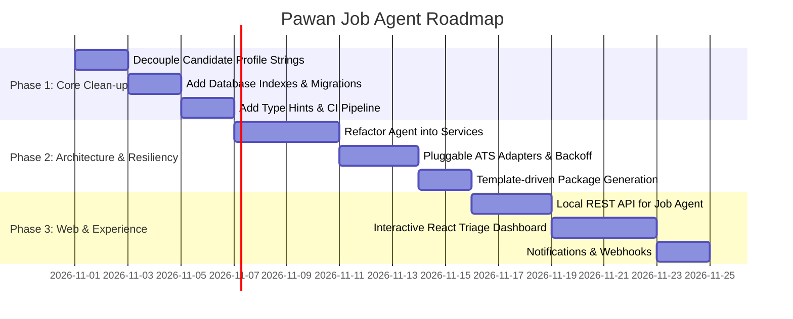

# Pawan Job Agent — System Improvement Plan & Roadmap

This document outlines architectural refactorings, feature additions, reliability enhancements, and developer experience improvements for the **Pawan Job Agent** (`pawan-job-agent` v0.2.0).

---

## Table of Contents

1. [Executive Summary & Priority Matrix](#1-executive-summary--priority-matrix)
2. [Architectural Decoupling & Modularization](#2-architectural-decoupling--modularization)
3. [Configuration & Profile Generalization](#3-configuration--profile-generalization)
4. [Storage, Schema Evolution & Database Migrations](#4-storage-schema-evolution--database-migrations)
5. [ATS Scraper Framework & Network Resiliency](#5-ats-scraper-framework--network-resiliency)
6. [Policy Evaluation & Match Engine Enhancements](#6-policy-evaluation--match-engine-enhancements)
7. [Application Packages & Templating Engine](#7-application-packages--templating-engine)
8. [Interactive Web Dashboard & Local REST API](#8-interactive-web-dashboard--local-rest-api)
9. [Observability, Structured Logging & Notifications](#9-observability-structured-logging--notifications)
10. [Testing, CI/CD & Developer Experience](#10-testing-cicd--developer-experience)
11. [Phased Implementation Roadmap](#11-phased-implementation-roadmap)

---

## 1. Executive Summary & Priority Matrix

| Category | Issue / Opportunity | Priority | Estimated Effort | Impact |
|---|---|---|---|---|
| **Architecture** | Hardcoded candidate profile strings in [`policy.py`](file:///e:/Projects/Job_automation/job_agent/policy.py) and [`packages.py`](file:///e:/Projects/Job_automation/job_agent/packages.py) | **P0 (Critical)** | Low (1-2 days) | Eliminates tight coupling; enables multi-profile or dynamic updates |
| **Architecture** | Monolithic `Agent` class in [`engine.py`](file:///e:/Projects/Job_automation/job_agent/engine.py) (568 lines) handling 6+ domains | **P1 (High)** | Medium (2-3 days) | Improves testability, maintainability, and code organization |
| **CLI** | 170-line `if/elif` command dispatch in [`cli.py`](file:///e:/Projects/Job_automation/job_agent/cli.py) | **P2 (Medium)** | Low (0.5 day) | Declarative command routing, easier command addition |
| **Database** | Raw SQL queries with no schema migration or indexing in [`store.py`](file:///e:/Projects/Job_automation/job_agent/store.py) | **P1 (High)** | Medium (1-2 days) | Prevents DB corruption during schema changes; boosts query performance |
| **Scrapers** | Scrapers tightly coupled in [`sources.py`](file:///e:/Projects/Job_automation/job_agent/sources.py); no retry backoff or pluggable providers | **P1 (High)** | Medium (2-3 days) | Allows easily adding Workday, BambooHR, SmartRecruiters, etc. |
| **Package Drafts** | Hardcoded email templates in [`packages.py`](file:///e:/Projects/Job_automation/job_agent/packages.py); no variant resumes | **P1 (High)** | Low (1 day) | Enables role-tailored outreach and multiple resume variants |
| **Web UI** | Static export in [`web/company-overview/`](file:///e:/Projects/Job_automation/web/company-overview); cannot approve/reject roles from UI | **P2 (Medium)** | Medium (3-4 days) | Streamlines daily triage and review workflow with a local UI |
| **Reliability** | No structured logging (`print`/`stderr` only); errors hard to trace | **P2 (Medium)** | Low (0.5 day) | Clear diagnostics and historical audit trails |
| **Testing & CI** | No CI pipeline (GitHub Actions), no coverage tracking, incomplete type hints | **P1 (High)** | Low (1 day) | Prevents regressions across Python 3.11, 3.12, 3.13 |

---

## 2. Architectural Decoupling & Modularization

### 2.1 Refactoring the Monolithic `Agent` Class
In [`job_agent/engine.py`](file:///e:/Projects/Job_automation/job_agent/engine.py), the `Agent` class currently centralizes:
- Board discovery and lead merging
- Policy evaluation and job preparation
- Report rendering and file export
- Review queue computation
- Approval management and cryptographic scope hashing
- Handoff generation and token creation
- Action result reconciliation
- Weekly analytics summaries

#### Recommended Architecture
Decompose `Agent` into specialized, single-responsibility services:
```
job_agent/
├── services/
│   ├── discovery.py       # DiscoveryService: thread-pool board scraping & lead deduplication
│   ├── evaluator.py       # EvaluationService: 16-gate policy runner & match scorer
│   ├── reporting.py       # ReportService: Markdown report rendering & companion JSONs
│   ├── approval.py        # ApprovalService: scope hashing, approvals, invalidation
│   ├── execution.py       # ExecutionService: handoffs, token issuing, result recording
│   └── analytics.py       # AnalyticsService: weekly rollups & cohort statistics
├── engine.py              # Lightweight facade coordinating services
```

### 2.2 Declarative Command Registry for `cli.py`
In [`job_agent/cli.py#L163-L332`](file:///e:/Projects/Job_automation/job_agent/cli.py#L163-L332), command dispatch is handled by a monolithic 170-line `if/elif` chain.

#### Proposed Solution
Use a lightweight command registry decorator pattern:
```python
# job_agent/cli_registry.py
COMMANDS = {}

def command(name: str):
    def decorator(fn):
        COMMANDS[name] = fn
        return fn
    return decorator

# Usage in commands:
@command("preflight")
def handle_preflight(args, agent):
    return agent.preflight()

@command("handoff")
def handle_handoff(args, agent):
    return agent.handoff(args.id, args.channel)

def dispatch(args, agent):
    handler = COMMANDS.get(args.command)
    if not handler:
        raise WorkflowError(f"Unsupported command: {args.command}")
    return handler(args, agent)
```

---

## 3. Configuration & Profile Generalization

### 3.1 Eliminating Hardcoded Candidate Attributes
Currently, [`job_agent/policy.py#L111-L115`](file:///e:/Projects/Job_automation/job_agent/policy.py#L111-L115) contains hardcoded candidate checks:
```python
branches = constraints.get("accepted_undergraduate_branches")
if branches and "mechanical engineering" not in {x.casefold() for x in branches}:
    override("undergraduate_branch", "FAIL", "B.E. is Mechanical Engineering; M.Tech does not override...")
```
And in [`job_agent/packages.py#L29-L43`](file:///e:/Projects/Job_automation/job_agent/packages.py#L29-L43):
```python
summary = [
    "M.Tech Information Technology student at NIT Jalandhar (2025–2027), with prior B.E. in Mechanical Engineering.",
    emphasis[family],
]
```

#### Proposed Solution
1. **Dynamic Gate Checking**: Compare the job's constraints directly against the candidate's `profile["education"]` records rather than literal strings:
   ```python
   candidate_branches = {
       edu["branch"].casefold()
       for edu in profile.get("education", [])
       if "branch" in edu
   }
   if branches and not candidate_branches.intersection({b.casefold() for b in branches}):
       primary_branch = profile["education"][0].get("branch", "unspecified")
       override("undergraduate_branch", "FAIL", f"Candidate branches ({', '.join(candidate_branches)}) not in accepted branches ({', '.join(branches)}).")
   ```
2. **Template-Driven Packages**: Read education summaries dynamically from `profile.json`.

---

## 4. Storage, Schema Evolution & Database Migrations

### 4.1 Schema Versioning & Migrations
Currently, [`job_agent/store.py`](file:///e:/Projects/Job_automation/job_agent/store.py) runs `CREATE TABLE IF NOT EXISTS` at runtime on every initialization. Modifying a column, renaming a field, or adding a constraint requires manual SQLite commands.

#### Proposed Solution
Implement a minimal migration runner in `store.py`:
- Create a `schema_migrations` table: `(version INTEGER PRIMARY KEY, applied_at TEXT NOT NULL, name TEXT NOT NULL)`
- Store ordered migration steps (e.g. `migrations/001_initial_schema.sql`, `migrations/002_add_indexes.sql`).
- Execute migrations sequentially within a single transaction during `Store.__init__()`.

### 4.2 SQLite Performance & Indexing
Add indexes on frequently queried and joined columns in [`data/ledger.sqlite3`](file:///e:/Projects/Job_automation/data/ledger.sqlite3):
```sql
CREATE INDEX IF NOT EXISTS idx_opportunities_state ON opportunities(state);
CREATE INDEX IF NOT EXISTS idx_opportunities_company_key ON opportunities(company_key);
CREATE INDEX IF NOT EXISTS idx_approvals_opportunity_id ON approvals(opportunity_id);
CREATE INDEX IF NOT EXISTS idx_approvals_scope_hash ON approvals(scope_hash);
CREATE INDEX IF NOT EXISTS idx_attempts_token ON attempts(token);
CREATE INDEX IF NOT EXISTS idx_attempts_opportunity_id ON attempts(opportunity_id);
CREATE INDEX IF NOT EXISTS idx_events_opportunity_id ON events(opportunity_id);
```

### 4.3 Query Abstraction (Repository Pattern)
Separate raw SQL statements from business logic into structured repository methods:
- `OpportunityRepository.get_by_id(job_id)`
- `OpportunityRepository.find_ready_for_review()`
- `ApprovalRepository.get_active(job_id, channel)`
- `EventRepository.record(action, result, evidence)`

---

## 5. ATS Scraper Framework & Network Resiliency

### 5.1 Pluggable Provider Architecture
[`job_agent/sources.py`](file:///e:/Projects/Job_automation/job_agent/sources.py) mixes HTML parsing, HTTP transport, and ATS board scraping.

#### Proposed Interface
```python
# job_agent/sources/base.py
class BaseATSAdapter(ABC):
    provider_name: str

    @abstractmethod
    def fetch_jobs(self, source_config: dict, http_client: HTTP) -> list[dict]:
        """Fetch and normalize job postings into canonical job dictionary format."""
        pass
```
Implement individual adapters:
- `GreenhouseAdapter`: `https://job-boards.greenhouse.io/{board}`
- `LeverAdapter`: `https://api.lever.co/v0/postings/{board}`
- `AshbyAdapter`: `https://api.ashbyhq.com/posting-api/job-board/{board}`
- `WorkableAdapter`: `https://apply.workable.com/api/v1/widget/accounts/{board}`
- `SmartRecruitersAdapter`: `https://api.smartrecruiters.com/v1/companies/{board}/postings`
- `WorkdayAdapter`: JSON-LD / career site parser

### 5.2 Network Resiliency & Rate Limiting
Enhance `HTTP.get()` in [`job_agent/sources.py#L56-L92`](file:///e:/Projects/Job_automation/job_agent/sources.py#L56-L92):
- **Exponential Backoff with Jitter**: On HTTP 429 (Rate Limit) or 503 (Service Unavailable), retry with `delay = min(max_delay, base * 2 ** attempt + random_jitter)`.
- **Per-Domain Rate Limiting**: Ensure at least `1.0s` spacing between successive requests to the same domain to respect ATS policies and prevent IP bans.
- **Configurable Request Headers**: Support optional custom proxy and headers via `config/settings.json`.

---

## 6. Policy Evaluation & Match Engine Enhancements

### 6.1 Configurable Policy Rules
Currently, all 16 gates in [`job_agent/policy.py`](file:///e:/Projects/Job_automation/job_agent/policy.py) are hardcoded. Extract rule parameters into `config/policy_rules.json`:
- Experience threshold limits (e.g. `max_experience_years: 2` for early-career roles)
- Required and excluded role keywords
- Accepted and restricted locations (e.g., India-eligible remote vs geo-restricted remote)
- Degree equivalencies (e.g., M.Tech IT + B.E. Mech accepted for general Software Engineering)

### 6.2 Advanced JD Parsing
In [`job_agent/evidence.py`](file:///e:/Projects/Job_automation/job_agent/evidence.py), regex-based experience extraction can be expanded to:
- Recognize degree requirements (`B.Tech`, `B.E.`, `M.S.`, `M.Tech`, `MCA`, `BCA`)
- Detect mandatory citizenship/visa restrictions (`US Citizen`, `Security Clearance required`, `EU work authorization only`)
- Detect compensation packages in varying currencies (USD/EUR) and convert to INR equivalent for floor comparison

---

## 7. Application Packages & Templating Engine

### 7.1 Pluggable Template System
In [`job_agent/packages.py`](file:///e:/Projects/Job_automation/job_agent/packages.py), email and outreach drafts use hardcoded strings.

#### Improvement
Use Python's built-in `string.Template` or modular formatting files:
- `templates/outreach/cloud_role.txt`
- `templates/outreach/backend_role.txt`
- `templates/outreach/sde_general.txt`
- `templates/follow_up/standard_follow_up.txt`

### 7.2 Multi-Resume Variant Support
Support multiple resume versions tailored to specific role families:
```
config/
├── settings.json
└── resumes/
    ├── cloud_devops_resume.pdf
    ├── backend_python_resume.pdf
    └── general_sde_resume.pdf
```
`packages.py` can automatically bind the optimal resume variant based on `role_family(job["role"])` and record its cryptographic hash in the approval package.

---

## 8. Interactive Web Dashboard & Local REST API

### 8.1 From Static Snapshot to Full Interactive Review UI
The React app in [`web/company-overview/`](file:///e:/Projects/Job_automation/web/company-overview) currently only reads static `.companies.json` files.

#### Proposed Capabilities
1. **Lightweight Local Backend**: Add a minimal local server (`python -m job_agent serve --port 8000` using standard library `http.server` or FastAPI):
   - `GET /api/queue` → Fetch prioritized review queue
   - `POST /api/approve` → Approve shortlisted job
   - `POST /api/skip` → Dismiss job
   - `POST /api/handoff` → Generate execution handoff package
   - `POST /api/record-result` → Submit confirmation token and evidence
2. **UI Enhancements**:
   - Filter by Match Score, Tier (GREAT / BETTER / GOOD), and Role Family
   - Visual eligibility gate breakdown (Green PASS / Red FAIL / Yellow UNKNOWN)
   - One-click copy for portal answers and cold email outreach drafts
   - Token & handoff management modal

---

## 9. Observability, Structured Logging & Notifications

### 9.1 Standardized Python `logging`
Replace raw `print()` statements with Python's built-in `logging`:
```python
# job_agent/logger.py
import logging

def get_logger(name: str) -> logging.Logger:
    logger = logging.getLogger(name)
    if not logger.handlers:
        handler = logging.StreamHandler()
        formatter = logging.Formatter(
            '{"time": "%(asctime)s", "level": "%(levelname)s", "module": "%(name)s", "msg": "%(message)s"}'
        )
        handler.setFormatter(formatter)
        logger.addHandler(handler)
        logger.setLevel(logging.INFO)
    return logger
```

### 9.2 Notification Integrations
Add optional webhook dispatchers (`job_agent/notifications.py`) when:
- Daily discovery finishes with newly shortlisted `READY_FOR_REVIEW` roles
- A 7-day follow-up check becomes due
- An approval token is within 12 hours of expiration

Supported channels:
- Local desktop notification (PowerShell toast notification on Windows)
- Discord / Telegram webhook
- SMTP email dispatch (using existing authorization settings)

---

## 10. Testing, CI/CD & Developer Experience

### 10.1 CI Workflow (GitHub Actions)
Add `.github/workflows/ci.yml`:
```yaml
name: CI

on: [push, pull_request]

jobs:
  test:
    runs-on: windows-latest
    strategy:
      matrix:
        python-version: ["3.11", "3.12", "3.13"]
    steps:
      - uses: actions/checkout@v4
      - name: Set up Python
        uses: actions/setup-python@v5
        with:
          python-version: ${{ matrix.python-version }}
      - name: Install package and test runner
        run: |
          pip install pytest pytest-cov ruff mypy
          pip install -e .
      - name: Lint and Format Check
        run: ruff check job_agent tests
      - name: Type Check
        run: mypy job_agent
      - name: Run Tests
        run: pytest --cov=job_agent tests/
```

### 10.2 Type Annotations & Linting
- Expand type hinting to all functions with `from __future__ import annotations`.
- Add `ruff` and `mypy` configuration to [`pyproject.toml`](file:///e:/Projects/Job_automation/pyproject.toml).

---

## 11. Phased Implementation Roadmap



### Phase 1: Core Clean-up & Safety (Immediate)
1. Parameterize candidate education in [`policy.py`](file:///e:/Projects/Job_automation/job_agent/policy.py) and remove hardcoded candidate strings.
2. Add database indexes in [`store.py`](file:///e:/Projects/Job_automation/job_agent/store.py) and implement a simple migration tracker.
3. Configure GitHub Actions CI and run `ruff` / `mypy` across the codebase.

### Phase 2: Architecture & Resiliency (Short-Term)
1. Split `Agent` in [`engine.py`](file:///e:/Projects/Job_automation/job_agent/engine.py) into dedicated service classes.
2. Abstract ATS adapters in [`sources.py`](file:///e:/Projects/Job_automation/job_agent/sources.py) with exponential backoff on HTTP 429.
3. Replace hardcoded copy in [`packages.py`](file:///e:/Projects/Job_automation/job_agent/packages.py) with template files and support multi-resume variants.

### Phase 3: Interactive Experience & Observability (Medium-Term)
1. Build a local API server command (`python -m job_agent serve`).
2. Upgrade the React dashboard in [`web/company-overview/`](file:///e:/Projects/Job_automation/web/company-overview) to support interactive triage, one-click review, and status tracking.
3. Add desktop toasts and webhook notifications for follow-ups and newly shortlisted roles.
