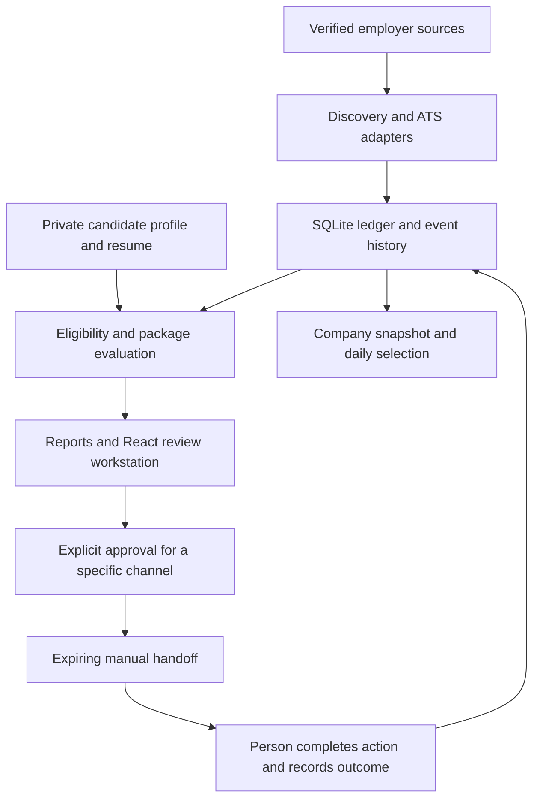

# Job Automation Agent

A local job discovery and application review system built with **Python, SQLite and React**. It collects opportunities from verified employer career sites, checks them against a candidate profile, creates evidence-based reports, and provides a dashboard for company research and application review.

**Current package version: 1.0.0.** The workflow combines recurring discovery with human review: discover opportunities, resolve missing information, review a report, approve a specific action, then record its actual outcome.

> Applications, recruiter outreach and follow-ups use explicit, expiring manual handoffs. A person submits the application or sends the message. The application does not control employer portals or send email.

## Contents

- [Features](#features)
- [Architecture](#architecture)
- [Requirements](#requirements)
- [First-time setup](#first-time-setup)
- [Configuration](#configuration)
- [Daily workflow](#daily-workflow)
- [Eligibility and scoring](#eligibility-and-scoring)
- [Local website and review API](#local-website-and-review-api)
- [Approval workflow](#approval-workflow)
- [Daily scheduling and notifications](#daily-scheduling-and-notifications)
- [Command reference](#command-reference)
- [Data, reports and backups](#data-reports-and-backups)
- [Development checks](#development-checks)
- [Troubleshooting](#troubleshooting)
- [Privacy and current limits](#privacy-and-current-limits)
- [Implementation records and roadmap](#implementation-records-and-roadmap)

## Features

| Capability | What it provides |
| --- | --- |
| Employer-verified discovery | Public ATS feeds and supported job pages linked from official employer websites. |
| Daily company selection | A configurable target of different companies, with persistent selection and reporting history. |
| Eligibility review | Sixteen core checks with `PASS`, `FAIL` and `UNKNOWN` results, supporting evidence and unresolved questions. |
| Company research | Company descriptions, CEO information, recent projects or updates, source links and research dates when available. |
| Role summaries | Job requirements, skills, location, employment type and official application links. |
| React review workstation | Search, filters, evidence editing, report review, approvals, handoffs and outcome recording. |
| Local ledger | SQLite storage, full-text search, migration checks, backups and an auditable event history. |
| Action controls | Separate channel approvals bound to the current profile, resume, vacancy and action package. |
| Operational visibility | Source health, discovery run history, in-app alerts and explicit desktop or webhook delivery. |

## Architecture



The `Agent` facade delegates discovery, evaluation, reporting, approval and execution to services. A separate packaging service prepares role-specific drafts. Public HTTP requests use bounded retries, per-host spacing, `Retry-After` handling and persistent ETag caching; circuit-breaker state lasts for the current process.

SQLite uses WAL mode, foreign keys, FTS5 and checksum-verified SQL migrations. Events publish after successful transactions. A local hash chain helps detect inconsistencies in event history; it does not provide an external immutable audit record.

| Layer | Technology |
| --- | --- |
| Workflow and local API | Python 3.11+, standard library |
| Storage and search | SQLite, JSON functions and FTS5 |
| Dashboard | React 19 and Vite |
| Recurring runs | Windows Task Scheduler |
| Quality checks | pytest, coverage, Hypothesis, Ruff and strict mypy |

## Requirements

- Python 3.11 or newer.
- Node.js and npm compatible with the frontend lockfile, for building or developing the React site.
- SQLite with FTS5 and JSON support (included with supported Python builds).
- Internet access for live discovery and initial dependency installation.
- Windows for the built-in scheduler installer and desktop notifications.

The Python runtime has no third-party package dependencies. The commands below use PowerShell; use `npm` instead of `npm.cmd` on other operating systems.

## First-time setup

### 1. Clone and configure

```powershell
git clone https://github.com/pawankgandhi15/Job_Automation.git
Set-Location Job_Automation

if (-not (Test-Path config/profile.json)) {
    Copy-Item config/profile.example.json config/profile.json
}
if (-not (Test-Path config/settings.json)) {
    Copy-Item config/settings.example.json config/settings.json
}
```

If the project is already cloned, start from its root directory. The copy commands preserve existing configuration.

**The example profile is a template, not a ready-to-run candidate profile.** Edit it before running the agent:

- Replace the example identity, contact details, education, experience, skills, work authorization and availability with your own confirmed information.
- Fill the required phone, LinkedIn and GitHub fields. Use valid HTTPS profile URLs and a real `YYYY-MM-DD` date for `reconfirm_after`.
- Replace the template's `location_mode: "unknown"` values with `role_dependent`, `remote`, `onsite` or `hybrid` as applicable, or omit that field. The literal value `unknown` is not accepted by the validator.
- Include a source and an offset-aware `confirmed_at` timestamp when supplying confirmed availability. Leave supported optional fields `null` when their values are unresolved.
- Review every settings default, including compensation floors, locations and the resume path. The example authorization flags and six-hour availability value must not be treated as your confirmed answers.

Place your resume locally and set `resume_path` in `config/settings.json`. Relative paths are resolved from the project root. The real profile, settings, PDFs, ledger, reports and handoffs are excluded from Git.

### 2. Validate and reconcile the resume

```powershell
python -m job_agent preflight
python -m job_agent db-status
python -m job_agent availability
```

Read the preflight output for unresolved requirements. After personally checking that the profile agrees with the exact resume file, record that review:

```powershell
python -m job_agent confirm-resume --file .\resume.pdf --profile-reviewed
```

Use your configured file path. This command records an attestation and file hash; it does not automatically verify the truth of the resume. Changes to the resume or relevant profile facts can require reconciliation again.

For an isolated synthetic report using the configured profile:

```powershell
python -m job_agent demo
```

The demo uses a separate ledger under `data/demo/`. It performs no live search, application, message delivery or schedule installation. It still requires valid local configuration.

### 3. Build and open the website

The production frontend is generated locally and is not committed. Build it before starting the website on a fresh clone:

```powershell
Push-Location web/company-overview
npm.cmd ci
npm.cmd run build
Pop-Location

python -m job_agent serve --port 8765
```

- Company dashboard: [http://127.0.0.1:8765/](http://127.0.0.1:8765/)
- Application review: [http://127.0.0.1:8765/review](http://127.0.0.1:8765/review)

Keep the terminal running while using the site. The company snapshot included with the repository is previously collected research; run discovery to obtain current results.

## Configuration

| File | Purpose |
| --- | --- |
| `config/profile.json` | Private candidate facts, education, evidence, authorization and availability. |
| `config/settings.json` | Private policy settings, source list, resume path and optional notification destination. |
| [config/profile.example.json](config/profile.example.json) | Public profile template to complete before use. |
| [config/settings.example.json](config/settings.example.json) | Public settings template. |
| [config/employers.json](config/employers.json) | Employer websites and career pages for source-pool verification. |
| [config/company_briefs.json](config/company_briefs.json) | Sourced company research used by company cards. |
| [config/role_briefs.json](config/role_briefs.json) | Additional sourced role information. |

Selected settings defaults:

| Setting | Default | Meaning |
| --- | --- | --- |
| `daily_company_target` | `5` | Target number of different companies for a day's selection. |
| `discovery_workers` | `3` | Concurrent discovery workers. |
| `max_leads_per_run` | `150` | Discovery intake limit per run. |
| `max_leads_per_company` | `10` | Discovery intake limit per company. |
| `shortlist_threshold` | `6.0` | Threshold on the existing 0-10 scoring scale. |
| `internship_monthly_floor_inr` | `15000` | Monthly internship compensation floor in INR. |
| `full_time_annual_floor_inr` | `600000` | Annual full-time compensation floor in INR. |
| `approval_hours` | `72` | Approval validity window. |
| `follow_up_days` | `7` | Default delay before considering a follow-up. |
| `history_complete` | `false` | Earlier application/report history remains unknown until reconciled. |

Changing a preference does not establish an employer requirement or turn missing evidence into a passing check. `report_email_authorized` alone does not configure an email provider; report email delivery is not implemented.

## Daily workflow

Run the complete daily workflow, then inspect the queue and source results:

```powershell
python -m job_agent daily
python -m job_agent review-queue --limit 20
python -m job_agent source-status
python -m job_agent runs --limit 5
```

`daily` verifies the configured employer pool at most once per IST day, discovers opportunities, writes reports, selects companies and refreshes the website snapshot. Previously selected or reported companies are not recycled to fill the target. Repeated runs on the same day preserve the selection and may add companies up to the target. A day can have fewer than five companies, including zero, when verified new companies are unavailable.

Use `discover` for discovery and reporting without the daily-selection workflow, or `company-web` to regenerate the company snapshot from the ledger. Discovery writes a Markdown report and companion review, queue and run JSON files under `reports/`. Generating a report does not mark it reviewed or email it.

Search the local ledger without making a network request:

```powershell
python -m job_agent search "Python backend" --state NEEDS_CLARIFICATION --limit 20
```

### Add verified sources

Supported public adapters cover **Greenhouse, Lever, Ashby, SmartRecruiters and Workable**, plus supported employer-published `JobPosting` structured data. The source must be linked from the employer's official site; a guessed ATS board token is not sufficient.

Replace these example values with an actual employer:

```powershell
python -m job_agent source-add --company "Example Employer" --website "https://example.com" --careers-url "https://example.com/careers" --tier GOOD
```

For the configured employer pool, run `python -m job_agent source-pool-refresh`. Unsupported sites can be handled through analyst-reviewed primary-source evidence using `import`; [examples/opportunity.sample.json](examples/opportunity.sample.json) shows the record format and contains synthetic opportunities.

Exact duplicate posting routes can share an existing ledger identity. Similar descriptions are flagged as possible cross-posts for review rather than automatically merged. `queries` produces browser search links; it does not perform global web searches or recruiter-contact research.

## Eligibility and scoring

The sixteen core gates cover employer identity, live vacancy, application route, location, work authorization, employment type, degree level, undergraduate branch, grades, experience, graduation batch, student status, start date, academic schedule, duration and essential skills.

- **PASS:** sufficient evidence supports the requirement.
- **FAIL:** the evidence establishes a conflict.
- **UNKNOWN:** information is missing, ambiguous or needs confirmation.

The 0-10 score considers technical fit, responsibilities, level and timeline, compensation, and company/role evidence. Missing inputs can leave the score unconfirmed. A high score does not override a failed or unresolved mandatory gate.

The agent does not invent degree equivalencies, convert undisclosed compensation, assume a full-time employer accepts reduced hours, or infer an exact joining date from a month. Resolve questions using candidate confirmation and official employer evidence before approval.

## Local website and review API

### Company dashboard

The company page offers today's selection and the full company list, text search, location and employment-type filters, sorting, and saved companies stored in the browser. Cards show company research, available role summaries and official **Apply** links. Source and research dates help distinguish recent information from older snapshots.

The page checks for snapshot updates while visible and when it regains focus. Refreshing a browser does not itself run discovery. Use `daily` for new results or `company-web` to export the current ledger. CEO and project information depends on sourced research; missing facts are not invented.

### Review workstation

At `/review`, inspect the queue by state, company tier or role family; read complete descriptions and gate evidence; record supported screening answers and declarations; review reports; and manage separate approvals, handoffs and outcomes. Activity updates use server-sent events.

| Shortcut | Action when available |
| --- | --- |
| `j` / `k` | Move through the queue. |
| `/` | Focus search. |
| `a` | Activate the approval control. |
| `s` | Skip or focus the skip-reason field. |
| `h` | Create a handoff. |
| `c` | Copy the prepared draft. |

Shortcuts do not override workflow requirements or intercept typing in form controls.

### Frontend development

Keep the Python service running on port `8765`. In another terminal, starting from the repository root:

```powershell
Push-Location web/company-overview
npm.cmd ci
npm.cmd run dev
```

Vite serves [http://127.0.0.1:5173](http://127.0.0.1:5173) and proxies `/api` to the Python server. Stop Vite with `Ctrl+C`, then use `Pop-Location` to return to the repository root. Rebuild after frontend changes when using the Python-served production site.

### API overview

All routes below are relative to `http://127.0.0.1:8765`. The browser handles the session automatically.

| Method and route | Purpose |
| --- | --- |
| `GET /api/v1/session` | Establish the local session and obtain a CSRF token. |
| `GET /api/v1/queue` | Search and filter the paginated review queue. |
| `GET /api/v1/opportunities/{id}` | Read an opportunity, its evidence, package and history. |
| `GET /api/v1/health` | Inspect local service health. |
| `GET /api/v1/notifications` | Read pending alerts. |
| `GET /api/v1/events/stream` | Subscribe to activity updates. |
| `POST /api/v1/reports` | Generate a review report. |
| `POST /api/v1/reports/{id}/review` | Record review of the exact report. |
| `POST /api/v1/opportunities/{id}/{action}` | Record evidence, answers, consent, rechecks, approval, a skip or a handoff. |
| `POST /api/v1/attempts/{token}/reconcile` | Record the observed outcome of a handoff. |

Protected routes require the session cookie. Writes also require the `X-Job-Agent-CSRF` header and an accepted local origin. Opportunity actions use `expected_scope_hash`; report review uses `expected_hash`. A stale review returns HTTP `409` so the user can reopen current information. See [server.py](job_agent/server.py) for request fields and validation.

The server binds to `127.0.0.1`. A hosted static page serves a company snapshot and the React shell; it does not host the private Python API or synchronize the ledger.

## Approval workflow

1. Resolve mandatory unknowns and conflicts using supported evidence. Confirm the profile, resume, required answers and declarations.
2. Generate and personally review the current report. Report creation alone does not record review.
3. Approve the exact action channel: `portal`, `outreach` or `follow_up`.
4. Complete the required current vacancy and destination checks, then create a single-use handoff.
5. Perform the action manually and record the outcome using actual provider evidence.

The CLI equivalent for a portal action is shown below. Replace the capitalized placeholders with returned IDs and genuine evidence; run each step only after completing its review:

```powershell
python -m job_agent report
# Read the generated report before recording its review.
python -m job_agent mark-delivered REPORT_ID
python -m job_agent approve OPPORTUNITY_ID --channels portal

# After personally checking the official vacancy, requirements and destination:
python -m job_agent recheck OPPORTUNITY_ID --evidence "OFFICIAL_URL and details of checks actually performed"
python -m job_agent handoff OPPORTUNITY_ID --channel portal

# After completing the action manually and observing confirmation:
python -m job_agent record-result HANDOFF_TOKEN --outcome confirmed --evidence "ACTUAL_PROVIDER_CONFIRMATION"
```

`mark-delivered` records that a local report was reviewed; it sends no email. Initial approval requires a recent reviewed report containing the current package. Manual/imported opportunities need a matching manual recheck within five minutes; supported sourced vacancies are refetched. Outreach and follow-up require a current manual recipient check.

Approval normally lasts 72 hours. A handoff consumes the applicable approval and expires no later than 24 hours after creation or the approval expiry, whichever comes first. Expiry does not restore consumed permission. Changes to the job, candidate facts, resume or action package invalidate stale authorization.

Valid outcomes are `confirmed`, `failed`, `uncertain` and `not_submitted`. An uncertain submission blocks retries until reconciled. Record late outcomes with their actual `--occurred-at` timestamp, including its UTC offset. Follow-ups require a separate approval, an authorized status check and the applicable waiting period; replies and terminal application states stop further follow-up.

## Daily scheduling and notifications

### Schedule discovery on Windows

After configuration and a successful manual daily run, install the recurring task:

```powershell
python -m job_agent schedule-install
python -m job_agent schedule-status
```

The installer registers daily discovery at **09:00 IST** under the configured task name, normally `JobAgent-DailyDiscovery`. It records the project path and Python interpreter. Use the same interpreter for installation and status checks; reinstalling with a different command requires resolving the existing task explicitly.

The machine must be available and the configured user signed in. The task can catch up after a missed trigger and avoids overlapping instances. Inspect `schedule-status`, `runs` and `data/daily/latest-result.json` for actual execution results. Installation is separate from starting the local website.

`schedule-template` only writes XML for a discovery task; it does not install one. `pause` blocks discovery and new handoffs in the ledger, while `resume` allows work again without reviving expired approvals. To stop scheduled launches themselves, disable the task in Windows Task Scheduler.

### Notifications

In-app alerts cover strong matches, follow-ups needing review, expiring handoffs and source anomalies. Daily runs scan for alerts; the local server also checks once per minute while running.

```powershell
python -m job_agent notifications
# Replace 123 with a pending alert ID to explicitly deliver that alert.
python -m job_agent notify --id 123 --channel desktop
```

For webhook delivery, configure `webhook_notifications` in private settings with `channel: "webhook"`, `enabled: true` and the destination `url`, then use `--channel webhook`. The endpoint must accept a JSON payload with a `content` field. Delivery is explicit; the scheduler does not automatically send these alerts or report emails.

## Command reference

Run commands from the repository root with `python -m job_agent`. Use `--help` or `<command> --help` for all arguments.

| Command | Purpose |
| --- | --- |
| `preflight`, `db-status`, `availability` | Inspect setup, schema and confirmed availability. |
| `source-add`, `source-pool-refresh` | Verify employer-linked discovery sources. |
| `discover`, `daily` | Discover opportunities; optionally select daily companies. |
| `source-status`, `runs --limit 5` | Inspect source checks and discovery history. |
| `review-queue --limit 20`, `status --id ID` | Inspect unresolved work or a specific opportunity. |
| `search "Python backend" --limit 20` | Search stored opportunities offline. |
| `report`, `mark-delivered REPORT_ID` | Generate a report, then record its review. |
| `company-web`, `serve --port 8765` | Export the company snapshot or start the local site. |
| `import FILE`, `export-opportunity ID --output FILE` | Import reviewed evidence or export a record for enrichment. |
| `record-answer`, `record-consent`, `recheck` | Record supported answers, declarations and verification. |
| `approve`, `handoff`, `record-result`, `check-status` | Manage approved manual actions and observed outcomes. |
| `skip ID`, `pause`, `resume` | Dismiss an opportunity or control ledger activity. |
| `notifications`, `notify` | Read alerts or explicitly deliver one. |
| `schedule-install`, `schedule-status`, `schedule-template` | Manage or inspect recurring discovery. |
| `export --output FILE` | Export private ledger data and history to JSON. |
| `queries`, `demo` | Generate search links or an isolated synthetic report. |

Global options precede the subcommand:

```powershell
python -m job_agent --root "E:\Projects\Job_automation" source-status
python -m job_agent --dry-run daily
```

`--dry-run` returns a non-executing plan before opening the ledger. It does not validate configuration, simulate discoveries or prove an action would succeed. JSON is the default output format. Normal handled completion exits with `0`; handled configuration/workflow errors use `2`; `discover` and `daily` use `3` when every checked source fails. Inspect result counts as well as the exit code, since an empty source list is not a successful live search.

## Data, reports and backups

| Location | Contents |
| --- | --- |
| `data/ledger.sqlite3` | Opportunities, approvals, attempts, reports, run history and daily-company history. |
| `data/backups/` | Consistent backups created before applicable schema migrations. |
| `data/http-cache/` | Persistent public-source HTTP cache. |
| `data/daily/latest-result.json` | Most recent daily-run result, with dated results alongside it. |
| `reports/` | Markdown reports and review, queue, run and company JSON artifacts. |
| `handoffs/` | Private manual action packages and attempt information. |
| `web/company-overview/public/` | Frontend assets and the generated company snapshot. |

Company snapshots export selected company and opportunity fields rather than the candidate profile, private drafts or raw ledger. Treat reports, handoffs and full ledger exports as private.

For backups outside migrations, stop writers or use SQLite's online backup API. Copying only the main database file while WAL writes are active can omit committed data. The JSON `export` command is an inspection/archive format, not a one-command database restore. Preserve configuration and resume files separately from database backups.

### Project layout

```text
Job_Automation/
  config/                     Public templates and private local configuration
  examples/                   Synthetic opportunity import examples
  job_agent/
    cli.py                    CLI parser and entry point
    commands.py               Command handlers
    engine.py                 Agent facade
    services/                 Discovery, evaluation, reporting and action services
    packaging.py              Action package preparation
    server.py                 Local review API and static site server
    sql/                      Versioned database migrations
    templates/                Role-family draft templates
  scripts/                    Scheduler, benchmarks and browser checks
  tests/                      Python tests and ATS fixtures
  web/company-overview/       React application and frontend tests
  .github/workflows/ci.yml    Python quality-check matrix
  PHASE1.md                   Foundation implementation record
  PHASES_2_3.md               Services and review workstation record
```

## Development checks

Create an isolated environment and install the development tools:

```powershell
python -m venv .venv
.venv\Scripts\python.exe -m pip install -e ".[dev]"
.venv\Scripts\python.exe -m ruff check job_agent tests
.venv\Scripts\python.exe -m ruff format --check job_agent tests
.venv\Scripts\python.exe -m mypy job_agent
.venv\Scripts\python.exe -m pytest --cov=job_agent --cov-fail-under=85
.venv\Scripts\python.exe -m build --no-isolation
```

For the React site:

```powershell
Push-Location web/company-overview
npm.cmd ci
npm.cmd test
npm.cmd run build
npm.cmd run test:browser
Pop-Location
```

The frontend browser check requires Chrome; `CHROME_PATH` can select its executable. Review-workstation smoke checks belong on an isolated synthetic ledger, not the live application history.

**Current test setup limitation:** Python fixtures copy `config/profile.json` and `config/settings.json`, which are intentionally excluded from Git. Some tests also depend on the original candidate fixture values and resume filename. A public clone needs suitable synthetic test configuration before the full suite can run reliably; completing the template with arbitrary personal details does not guarantee fixture compatibility. The CI workflow currently does not provision that configuration.

[GitHub Actions configuration](.github/workflows/ci.yml) defines Python 3.11-3.13 checks on Windows and Linux, linting, formatting, strict typing, an 85% coverage threshold and package builds. It does not currently run the frontend checks. Historical local results are recorded in [PHASES_2_3.md](PHASES_2_3.md); those results do not establish the current remote CI status.

Optional synthetic performance checks are available through `python -m scripts.benchmark_search` and `python -m scripts.benchmark_review_api`. Their local timings are hardware-dependent.

## Troubleshooting

| Symptom | What to check |
| --- | --- |
| Configuration validation fails | Complete the required profile fields, dates and availability values; the example files contain placeholders. |
| Resume is absent or unreconciled | Check `resume_path`, inspect the exact file, then use `confirm-resume --profile-reviewed` after reviewing it. |
| No opportunities appear | Check the configured source list, employer verification, `source-status` and `runs`. Search links alone do not collect vacancies. |
| Fewer than the target number of companies | The daily selection excludes previous selections/reported companies and cannot guarantee fresh vacancies. |
| The website is missing or outdated | Build the frontend, start the Python server, then run `daily` or `company-web` to refresh the snapshot. |
| The Vite page opens but API calls fail | Ensure the Python service is running on `127.0.0.1:8765` and use the local Vite URL. |
| An approval or handoff is blocked | Resolve unknown gates, required answers, resume review, report review and current verification requirements. |
| HTTP `409` appears | The reviewed report or action package changed; reopen it and review the current version. |
| Submission status is uncertain | Reconcile the existing attempt using actual provider evidence before attempting again. |
| The daily task does not run | Inspect `schedule-status`, interpreter/project paths, the signed-in account and Windows Task Scheduler history. |
| Tests fail on a fresh clone | Review the local-configuration dependency described in [Development checks](#development-checks). |
| SQLite reports missing FTS5 or JSON support | Use a Python/SQLite build providing both required features. |

## Privacy and current limits

Keep real profiles, settings, resumes, tokens, webhook credentials, `data/`, `reports/` and `handoffs/` out of public commits. Review staged files before publishing; an ignore rule does not remove a file already tracked by Git.

The current implementation has these boundaries:

- Employer applications, browser logins, recruiter messages and follow-ups remain manual actions with explicit approval controls.
- Global web search and recruiter-contact research require an analyst. Supported public source adapters do not cover every employer; Workday is currently unsupported.
- Company leadership and project summaries are only as current as their cited research. The system does not guarantee complete company intelligence or daily new vacancies.
- Earlier applications and company reports remain unknown until their history is reconciled. A new local ledger cannot prove that a candidate has never applied elsewhere.
- Draft templates and separately attested resume variants are supported; automated resume PDF generation is not implemented.
- Static hosting does not expose or host the local review backend. Multi-user remote deployment and SMTP report delivery are not provided.

## Implementation records and roadmap

| Document | Contents |
| --- | --- |
| [Phase 1](PHASE1.md) | Configuration, ledger migration, search and development foundations. |
| [Phases 2 and 3](PHASES_2_3.md) | Service separation, discovery resilience, review API, dashboard and historical verification. |
| [Technical roadmap](pawan_job_agent_system_improvement_plan_roadmap.md) | Proposed architecture and phased improvement plan. |
| [Frontend README](web/company-overview/README.md) | Additional company-dashboard development notes. |

The roadmap includes proposed extensions. Use the implementation records and current code to distinguish shipped features from future work.
