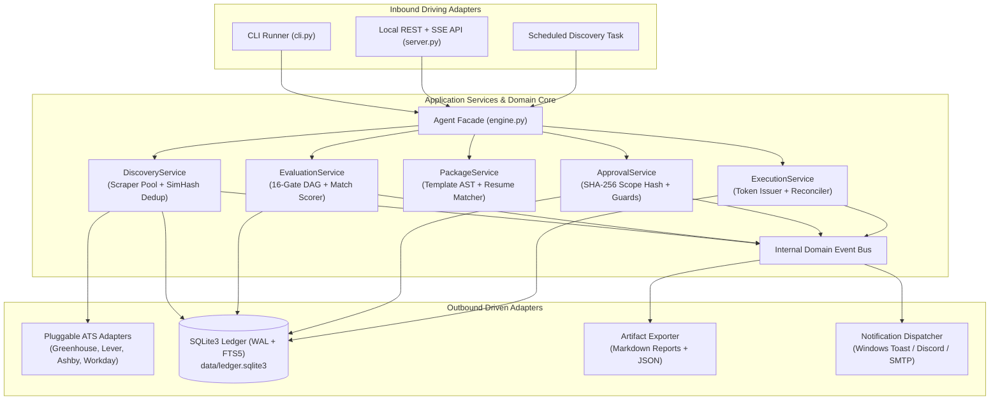
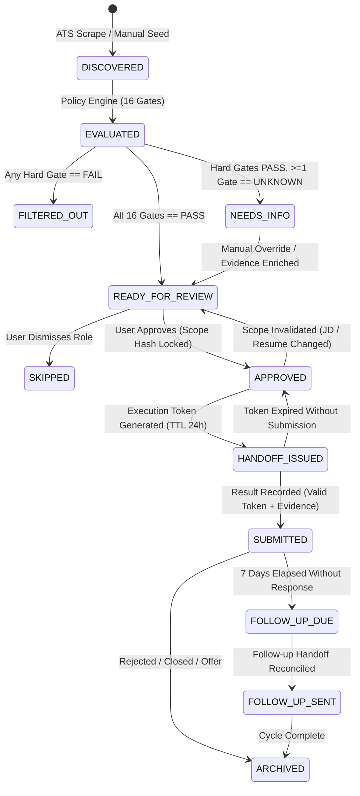
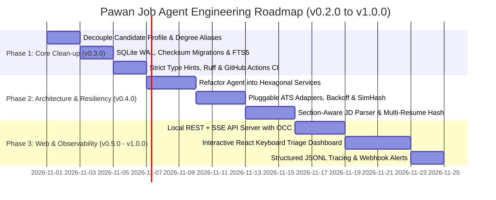

# Pawan Job Agent — System Improvement Plan & Architectural Roadmap

**Target Package:** `pawan-job-agent` (`v0.2.0` $\rightarrow$ `v1.0.0`)  
**Runtime Baseline:** Python $\ge 3.11$ | SQLite 3 (WAL Mode + FTS5) | React 18 (Local Triage Workstation)  
**Architecture Paradigm:** Hexagonal (Ports & Adapters), Event-Driven Lifecycle, Cryptographic Scope Auditing

This document defines the comprehensive engineering specification, architectural refactorings, reliability patterns, data storage migrations, and developer experience improvements required to evolve **Pawan Job Agent** from a monolithic CLI script into a resilient, extensible, and observable job discovery and application orchestration platform.

---

## Table of Contents

1. [Executive Summary, SLOs & Priority Matrix](#1-executive-summary-slos--priority-matrix)
2. [Target System Architecture & Domain State Machine](#2-target-system-architecture--domain-state-machine)
3. [Architectural Decoupling & Hexagonal Modularization](#3-architectural-decoupling--hexagonal-modularization)
4. [Configuration Contracts & Multi-Profile Generalization](#4-configuration-contracts--multi-profile-generalization)
5. [Storage Engine, Concurrency, FTS5 & Schema Migrations](#5-storage-engine-concurrency-fts5--schema-migrations)
6. [High-Resiliency ATS Scraper Framework & Fuzzy Deduplication](#6-high-resiliency-ats-scraper-framework--fuzzy-deduplication)
7. [Composable Policy DAG & Hybrid Match Scoring Engine](#7-composable-policy-dag--hybrid-match-scoring-engine)
8. [Deterministic Application Packages & Resume Variant Binding](#8-deterministic-application-packages--resume-variant-binding)
9. [Interactive Web Dashboard, Local REST/SSE API & Triage UX](#9-interactive-web-dashboard-local-restsse-api--triage-ux)
10. [Observability, Correlation Tracing & Anomaly Alerting](#10-observability-correlation-tracing--anomaly-alerting)
11. [Testing Pyramid, Property-Based Fuzzing & CI/CD Gates](#11-testing-pyramid-property-based-fuzzing--cicd-gates)
12. [Phased Implementation Roadmap & Definition of Done](#12-phased-implementation-roadmap--definition-of-done)

---

## 1. Executive Summary, SLOs & Priority Matrix

### 1.1 Engineering Objectives & Service Level Objectives (SLOs)

To scale daily job triage across dozens of ATS boards without silent failures, data corruption, or manual bottlenecking, the `v1.0.0` architecture targets the following operational metrics:

- **Zero Profile Coupling:** $100\%$ of candidate attributes, degree equivalencies, and outreach templates must be externalized into schema-validated configuration files.
- **Discovery Resiliency:** A single failing or rate-limiting ATS endpoint must never crash a discovery run; per-domain circuit breakers and decorrelated exponential backoff with jitter must isolate transient network faults.
- **Cryptographic Approval Integrity:** Every human approval must bind to an immutable SHA-256 `scope_hash` computed over the normalized job payload, selected resume binary digest, and rendered outreach draft.
- **Sub-50ms Local Query Latency:** SQLite indexing, Write-Ahead Logging (`WAL`), and Full-Text Search (`FTS5`) must keep p95 queue and filter queries under $50\text{ ms}$ at $50,000+$ stored opportunities.

### 1.2 Master Priority Matrix

| ID | Category | Issue / Architectural Opportunity | Priority | Estimated Effort | Target Release | Impact |
|---|---|---|---|---|---|---|
| **ARC-01** | **Config & Policy** | Hardcoded candidate profile strings in [`policy.py`](file:///e:/Projects/Job_automation/job_agent/policy.py) and [`packages.py`](file:///e:/Projects/Job_automation/job_agent/packages.py) | **P0 (Critical)** | Low (1–2 days) | `v0.3.0` | Eliminates tight coupling; enables multi-profile or dynamic updates |
| **DB-01** | **Storage Engine** | Raw SQL queries with no schema migration runner, no `WAL` mode, and missing indexes in [`store.py`](file:///e:/Projects/Job_automation/job_agent/store.py) | **P0 (Critical)** | Medium (2 days) | `v0.3.0` | Prevents DB corruption during schema changes; allows concurrent API reads + scraper writes |
| **ARC-02** | **Core Engine** | Monolithic `Agent` class in [`engine.py`](file:///e:/Projects/Job_automation/job_agent/engine.py) (568 lines) handling $6+$ domains | **P1 (High)** | Medium (3 days) | `v0.4.0` | Enforces Single Responsibility Principle (SRP), testability, and clean module boundaries |
| **SCR-01** | **ATS Scrapers** | Scrapers tightly coupled in [`sources.py`](file:///e:/Projects/Job_automation/job_agent/sources.py); no retry backoff, `ETag` caching, or circuit breakers | **P1 (High)** | Medium (3 days) | `v0.4.0` | Allows easily adding Workday, Ashby, SmartRecruiters, BambooHR; prevents IP bans |
| **POL-01** | **Match Engine** | Rigid 16-gate procedural evaluation in [`policy.py`](file:///e:/Projects/Job_automation/job_agent/policy.py) and naive regex parsing in [`evidence.py`](file:///e:/Projects/Job_automation/job_agent/evidence.py) | **P1 (High)** | Medium (2–3 days) | `v0.4.0` | Section-aware JD extraction, configurable rules, and calibrated match scoring |
| **PKG-01** | **Package Drafts** | Hardcoded email templates in [`packages.py`](file:///e:/Projects/Job_automation/job_agent/packages.py); no multi-resume variant support | **P1 (High)** | Low (1.5 days) | `v0.4.0` | Role-tailored outreach with AST validation and SHA-256 resume variant binding |
| **QA-01** | **Testing & CI** | No CI pipeline (GitHub Actions), incomplete type hints, no offline ATS fixture tests | **P1 (High)** | Low (1.5 days) | `v0.3.0` | Prevents regressions across Python 3.11, 3.12, and 3.13 with $\ge 85\%$ coverage |
| **CLI-01** | **CLI Dispatch** | 170-line `if/elif` command dispatch in [`cli.py`](file:///e:/Projects/Job_automation/job_agent/cli.py) | **P2 (Medium)** | Low (0.5 day) | `v0.4.0` | Declarative command routing, `--json` and `--dry-run` flags, standardized exit codes |
| **WEB-01** | **Web UI & API** | Static export in [`web/company-overview/`](file:///e:/Projects/Job_automation/web/company-overview); cannot approve/reject roles from UI | **P2 (Medium)** | High (4 days) | `v0.5.0` | Full local REST/SSE server with keyboard-driven (`j`/`k`/`a`/`s`) triage workflow |
| **OBS-01** | **Observability** | Unstructured `print`/`stderr` logging; no trace correlation IDs or scraper anomaly alerts | **P2 (Medium)** | Low (1 day) | `v0.5.0` | Structured JSONL audit trails, `contextvars` tracing, and desktop/webhook notifications |

---

## 2. Target System Architecture & Domain State Machine

### 2.1 End-to-End Hexagonal Data Flow

The refactored system separates **Inbound Driving Adapters** (CLI, Local HTTP/SSE Server, Scheduled Tasks), **Core Application Services & Domain Models**, and **Outbound Driven Adapters** (ATS Providers, SQLite Ledger, File Exporters, Notification Channels).



### 2.2 Formal Opportunity Lifecycle State Machine

Currently, state mutations happen via loosely coordinated string updates. The improved architecture enforces a strict **Finite State Machine (FSM)** where invalid transitions raise a `StateTransitionError` and every valid transition emits an immutable ledger event.



---

## 3. Architectural Decoupling & Hexagonal Modularization

### 3.1 Refactoring the Monolithic `Agent` Class (`ARC-02`)

In [`job_agent/engine.py`](file:///e:/Projects/Job_automation/job_agent/engine.py), the `Agent` class currently centralizes board discovery, lead merging, policy evaluation, report rendering, review queue computation, approval scope hashing, handoff token generation, result reconciliation, and weekly analytics across $568$ lines.

#### Recommended Directory & Service Decomposition

```text
job_agent/
├── domain/
│   ├── models.py          # Immutable dataclasses: Opportunity, GateEvaluation, ApprovalScope, AttemptToken
│   ├── states.py          # OpportunityState enum & FSM transition matrix validation
│   └── events.py          # Domain event payloads (OpportunityDiscovered, OpportunityApproved, etc.)
├── ports/
│   ├── repositories.py    # typing.Protocol interfaces for storage repositories
│   └── ats.py             # typing.Protocol for ATS scraping adapters
├── services/
│   ├── discovery.py       # DiscoveryService: bounded thread-pool scraping, ETag check, SimHash dedup
│   ├── evaluator.py       # EvaluationService: 16-gate rule runner & multi-factor scorer
│   ├── packaging.py       # PackageService: resume variant binding & template rendering
│   ├── approval.py        # ApprovalService: canonical SHA-256 scope hashing & invalidation
│   ├── execution.py       # ExecutionService: TTL token generation & submission reconciliation
│   ├── reporting.py       # ReportService: Markdown report & companion .companies.json generation
│   └── analytics.py       # AnalyticsService: cohort conversion funnels & weekly rollups
├── adapters/
│   ├── storage/           # SQLite repositories & migration runner
│   ├── sources/           # Greenhouse, Lever, Ashby, Workable, SmartRecruiters, Workday adapters
│   ├── notifications/     # Windows Toast, Webhook, and SMTP dispatchers
│   └── api/               # Local HTTP/SSE server for interactive web dashboard
├── cli_registry.py        # Decorator-driven CLI router & middleware
├── engine.py              # Lightweight Facade coordinating services (< 120 lines)
└── cli.py                 # Argument parser & entrypoint
```

### 3.2 Internal Domain Event Bus

To decouple core state changes from side effects (such as regenerating Markdown reports or firing notifications), services publish strongly typed domain events:

```python
# job_agent/domain/events.py
from __future__ import annotations
from dataclasses import dataclass, field
from datetime import datetime, timezone
from typing import Callable, Type, TypeVar

@dataclass(frozen=True, slots=True)
class DomainEvent:
    occurred_at: str = field(default_factory=lambda: datetime.now(timezone.utc).isoformat())

@dataclass(frozen=True, slots=True)
class OpportunityApproved(DomainEvent):
    opportunity_id: str = ""
    channel: str = ""
    scope_hash: str = ""
    resume_variant: str = ""

E = TypeVar("E", bound=DomainEvent)

class EventBus:
    def __init__(self) -> None:
        self._subscribers: dict[Type[DomainEvent], list[Callable[[DomainEvent], None]]] = {}

    def subscribe(self, event_type: Type[E], handler: Callable[[E], None]) -> None:
        self._subscribers.setdefault(event_type, []).append(handler)  # type: ignore[arg-type]

    def publish(self, event: DomainEvent) -> None:
        for handler in self._subscribers.get(type(event), []):
            handler(event)
```

### 3.3 Declarative Command Registry for `cli.py` (`CLI-01`)

In [`job_agent/cli.py#L163-L332`](file:///e:/Projects/Job_automation/job_agent/cli.py#L163-L332), command dispatch is handled by a monolithic $170$-line `if/elif` chain. Replace it with a type-safe decorator registry supporting global `--json` and `--dry-run` flags:

```python
# job_agent/cli_registry.py
from __future__ import annotations
import argparse
import json
import sys
from dataclasses import dataclass
from typing import Any, Protocol
from job_agent.exceptions import WorkflowError

class CommandHandler(Protocol):
    def __call__(self, args: argparse.Namespace, agent: Any) -> dict[str, Any]: ...

@dataclass(frozen=True, slots=True)
class CommandSpec:
    name: str
    help_text: str
    handler: CommandHandler
    mutates_state: bool = False

COMMANDS: dict[str, CommandSpec] = {}

def command(name: str, *, help_text: str = "", mutates_state: bool = False):
    def decorator(fn: CommandHandler) -> CommandHandler:
        COMMANDS[name] = CommandSpec(
            name=name,
            help_text=help_text,
            handler=fn,
            mutates_state=mutates_state,
        )
        return fn
    return decorator

@command("preflight", help_text="Validate configuration, DB migrations, and resume files")
def handle_preflight(args: argparse.Namespace, agent: Any) -> dict[str, Any]:
    return agent.preflight()

@command("handoff", help_text="Issue execution token for an approved role", mutates_state=True)
def handle_handoff(args: argparse.Namespace, agent: Any) -> dict[str, Any]:
    return agent.handoff(args.id, args.channel)

def dispatch(args: argparse.Namespace, agent: Any) -> int:
    spec = COMMANDS.get(args.command)
    if not spec:
        raise WorkflowError(f"Unsupported command: {args.command}")

    if getattr(args, "dry_run", False) and spec.mutates_state:
        agent.store.enable_rollback_only_mode()

    result = spec.handler(args, agent)
    if getattr(args, "json", False):
        sys.stdout.write(json.dumps(result, indent=2, sort_keys=True) + "\n")
    return 0
```

---

## 4. Configuration Contracts & Multi-Profile Generalization

### 4.1 Eliminating Hardcoded Candidate Attributes (`ARC-01`)

Currently, [`job_agent/policy.py#L111-L115`](file:///e:/Projects/Job_automation/job_agent/policy.py#L111-L115) contains hardcoded candidate checks:

```python
branches = constraints.get("accepted_undergraduate_branches")
if branches and "mechanical engineering" not in {x.casefold() for x in branches}:
    override("undergraduate_branch", "FAIL", "B.E. is Mechanical Engineering; M.Tech does not override...")
```

And [`job_agent/packages.py#L29-L43`](file:///e:/Projects/Job_automation/job_agent/packages.py#L29-L43) hardcodes education summary strings:

```python
summary = [
    "M.Tech Information Technology student at NIT Jalandhar (2025–2027), with prior B.E. in Mechanical Engineering.",
    emphasis[family],
]
```

#### Proposed Solution: Hierarchical Profile Schema & Alias-Aware Gate Checking

1. **Structured Candidate Profile (`config/profile.json`):**

```json
{
  "candidate_id": "pawan-kumar-v1",
  "full_name": "Pawan Kumar",
  "headline_summary": "M.Tech Information Technology student at NIT Jalandhar (2025–2027), with prior B.E. in Mechanical Engineering.",
  "education": [
    {
      "level": "postgraduate",
      "degree": "M.Tech",
      "branch": "Information Technology",
      "branch_aliases": ["it", "computer science", "cs", "circuit branches", "software engineering"],
      "institution": "NIT Jalandhar",
      "start_year": 2025,
      "graduation_year": 2027,
      "cgpa": 8.4
    },
    {
      "level": "undergraduate",
      "degree": "B.E.",
      "branch": "Mechanical Engineering",
      "branch_aliases": ["mechanical", "mech", "all engineering branches"],
      "institution": "Previous University",
      "start_year": 2020,
      "graduation_year": 2024,
      "cgpa": 7.9
    }
  ],
  "compensation_floor_inr_lpa": 6.0,
  "work_authorization": ["IN"],
  "preferred_locations": ["Bengaluru", "Hyderabad", "Pune", "Noida", "Gurugram", "Remote (India)"]
}
```

2. **Dynamic Gate Checking with Postgraduate Equivalency Support:**

```python
def evaluate_undergraduate_branch_gate(
    constraints: dict[str, Any], profile: dict[str, Any]
) -> tuple[str, str]:
    required_ug_branches = {
        b.casefold().strip() for b in constraints.get("accepted_undergraduate_branches", [])
    }
    if not required_ug_branches:
        return ("PASS", "No strict undergraduate branch restriction specified.")

    ug_records = [
        edu for edu in profile.get("education", [])
        if edu.get("level", "").casefold() == "undergraduate"
    ]
    candidate_ug_tokens: set[str] = set()
    for edu in ug_records:
        if "branch" in edu:
            candidate_ug_tokens.add(edu["branch"].casefold())
        candidate_ug_tokens.update(a.casefold() for a in edu.get("branch_aliases", []))

    matched = required_ug_branches.intersection(candidate_ug_tokens)
    if matched:
        return ("PASS", f"Undergraduate branch matches accepted criteria: {', '.join(sorted(matched))}.")

    if constraints.get("allow_postgraduate_cs_override", False):
        pg_tokens = {
            alias.casefold()
            for edu in profile.get("education", [])
            if edu.get("level", "").casefold() == "postgraduate"
            for alias in [edu.get("branch", ""), *edu.get("branch_aliases", [])]
        }
        if required_ug_branches.intersection(pg_tokens):
            return ("PASS", "Satisfied via postgraduate CS/IT equivalency override.")

    primary_ug = ug_records[0].get("branch", "Unspecified") if ug_records else "None"
    return (
        "FAIL",
        f"Candidate undergraduate branch ({primary_ug}) not in accepted set ({', '.join(sorted(required_ug_branches))})."
    )
```

---

## 5. Storage Engine, Concurrency, FTS5 & Schema Migrations

### 5.1 SQLite Concurrency & Performance Tuning (`DB-01`)

When the local web dashboard (`serve`) runs concurrently with background CLI discovery (`discover`), default SQLite locking can raise `sqlite3.OperationalError: database is locked`. Configure all connections in [`job_agent/store.py`](file:///e:/Projects/Job_automation/job_agent/store.py) with production PRAGMAs:

```sql
PRAGMA journal_mode = WAL;          -- Concurrent readers with non-blocking single writer
PRAGMA synchronous = NORMAL;        -- Safe durability in WAL mode with 3x-5x faster commits
PRAGMA foreign_keys = ON;           -- Enforce relational integrity across approvals & attempts
PRAGMA busy_timeout = 5000;         -- Wait up to 5000ms on write lock contention before failing
PRAGMA temp_store = MEMORY;         -- Keep temporary sort/index tables in RAM
PRAGMA cache_size = -32000;         -- Allocate 32MB page cache
```

### 5.2 Checksum-Verified Schema Migration Runner

Currently, [`job_agent/store.py`](file:///e:/Projects/Job_automation/job_agent/store.py) executes `CREATE TABLE IF NOT EXISTS` on initialization. Implement a deterministic migration runner that tracks version numbers and SHA-256 checksums of ordered SQL files (`migrations/001_initial_schema.sql`, `migrations/002_indexes_and_fts.sql`):

```python
# job_agent/adapters/storage/migrations.py
from __future__ import annotations
import hashlib
import sqlite3
from pathlib import Path
from datetime import datetime, timezone

class MigrationError(RuntimeError):
    pass

def run_migrations(conn: sqlite3.Connection, migrations_dir: Path) -> list[str]:
    conn.execute("""
        CREATE TABLE IF NOT EXISTS schema_migrations (
            version INTEGER PRIMARY KEY,
            name TEXT NOT NULL,
            checksum TEXT NOT NULL,
            applied_at TEXT NOT NULL
        );
    """)
    applied: dict[int, tuple[str, str]] = {
        row[0]: (row[1], row[2])
        for row in conn.execute("SELECT version, name, checksum FROM schema_migrations").fetchall()
    }

    applied_now: list[str] = []
    for sql_file in sorted(migrations_dir.glob("*.sql")):
        version = int(sql_file.stem.split("_", 1)[0])
        content = sql_file.read_text(encoding="utf-8")
        checksum = hashlib.sha256(content.encode("utf-8")).hexdigest()

        if version in applied:
            old_name, old_checksum = applied[version]
            if old_checksum != checksum:
                raise MigrationError(
                    f"Migration checksum mismatch for v{version} ({sql_file.name}): "
                    f"expected {old_checksum}, got {checksum}"
                )
            continue

        with conn:
            conn.executescript(content)
            conn.execute(
                "INSERT INTO schema_migrations (version, name, checksum, applied_at) VALUES (?, ?, ?, ?)",
                (version, sql_file.name, checksum, datetime.now(timezone.utc).isoformat()),
            )
        applied_now.append(sql_file.name)
    return applied_now
```

### 5.3 SQLite Indexing & Full-Text Search (`FTS5`)

Add composite indexes and an `FTS5` virtual table in [`data/ledger.sqlite3`](file:///e:/Projects/Job_automation/data/ledger.sqlite3) via `migrations/002_indexes_and_fts.sql`:

```sql
CREATE INDEX IF NOT EXISTS idx_opportunities_state_score 
    ON opportunities(state, match_score DESC, updated_at DESC);
CREATE INDEX IF NOT EXISTS idx_opportunities_company_key 
    ON opportunities(company_key);
CREATE INDEX IF NOT EXISTS idx_opportunities_fingerprint 
    ON opportunities(canonical_fingerprint);
CREATE INDEX IF NOT EXISTS idx_approvals_opportunity_id 
    ON approvals(opportunity_id);
CREATE INDEX IF NOT EXISTS idx_approvals_scope_hash 
    ON approvals(scope_hash);
CREATE INDEX IF NOT EXISTS idx_attempts_token 
    ON attempts(token);
CREATE INDEX IF NOT EXISTS idx_attempts_opportunity_id 
    ON attempts(opportunity_id);
CREATE INDEX IF NOT EXISTS idx_events_opportunity_id 
    ON events(opportunity_id, created_at DESC);

-- Full-Text Search virtual table for instant keyword filtering across JDs
CREATE VIRTUAL TABLE IF NOT EXISTS opportunities_fts USING fts5(
    opportunity_id UNINDEXED,
    company,
    role,
    location,
    description_text,
    tokenize='porter unicode61'
);
```

### 5.4 Cryptographic Hash-Chained Audit Ledger & Repository Pattern

1. **Repository Abstraction:** Encapsulate SQL queries inside dedicated repositories (`OpportunityRepository`, `ApprovalRepository`, `AttemptRepository`, `EventRepository`).
2. **Hash-Chained Audit Events:** Each row in `events` computes a tamper-evident hash chain:

$$
\text{event\_hash}_n = \text{SHA256}\left(\text{event\_hash}_{n-1} \parallel \text{canonical\_json}(\text{payload}_n)\right)
$$

---

## 6. High-Resiliency ATS Scraper Framework & Fuzzy Deduplication

### 6.1 Pluggable Provider Architecture (`SCR-01`)

[`job_agent/sources.py`](file:///e:/Projects/Job_automation/job_agent/sources.py) currently mixes HTML parsing, HTTP transport, and ATS board scraping. Extract a formal `BaseATSAdapter` contract:

```python
# job_agent/ports/ats.py
from __future__ import annotations
from abc import ABC, abstractmethod
from dataclasses import dataclass
from typing import Any

@dataclass(frozen=True, slots=True)
class RawJobPosting:
    external_id: str
    company: str
    role: str
    location: str
    apply_url: str
    description_html: str
    description_text: str
    department: str | None = None
    posted_at: str | None = None
    compensation_raw: str | None = None
    metadata: dict[str, Any] | None = None

class BaseATSAdapter(ABC):
    provider_name: str

    @abstractmethod
    def fetch_jobs(self, source_config: dict[str, Any], http_client: Any) -> list[RawJobPosting]:
        """Fetch and normalize job postings into canonical RawJobPosting records."""
        raise NotImplementedError
```

| Adapter Class | Target Endpoint Pattern | Notes |
|---|---|---|
| `GreenhouseAdapter` | `https://boards-api.greenhouse.io/v1/boards/{board}/jobs?content=true` | Supports `ETag` conditional caching |
| `LeverAdapter` | `https://api.lever.co/v0/postings/{board}?mode=json` | Extracts structured `lists` and `descriptionPlain` |
| `AshbyAdapter` | `https://api.ashbyhq.com/posting-api/job-board/{board}?includeCompensation=true` | Native compensation metadata support |
| `WorkableAdapter` | `https://apply.workable.com/api/v3/accounts/{board}/jobs` | Cursor-based pagination via `nextPage` |
| `SmartRecruitersAdapter` | `https://api.smartrecruiters.com/v1/companies/{board}/postings` | Offset/limit pagination + detail fetch |
| `WorkdayAdapter` | `POST https://{tenant}.wd{n}.myworkdayjobs.com/wday/cxs/{tenant}/{site}/jobs` | JSON CXS endpoint + `application/ld+json` fallback |

### 6.2 Network Resiliency, Rate Limiting & Circuit Breakers

Enhance `HTTP.get()` in [`job_agent/sources.py#L56-L92`](file:///e:/Projects/Job_automation/job_agent/sources.py#L56-L92):

- **Exponential Backoff with Jitter:** On `HTTP 429` or `503`, retry up to $A_{\max} = 4$ attempts using delay:

$$
d(a) = \min\left(D_{\max}, \; D_{\text{base}} \cdot 2^{a - 1} + \text{Uniform}(0, J_{\max})\right)
$$

  while honoring any server-supplied `Retry-After` header.
- **Per-Domain Token Bucket Rate Limiting:** Enforce at least $1.0\text{ s}$ spacing between successive requests to the same ATS host to prevent IP blocks.
- **Per-Host Circuit Breaker:** If a domain fails $\theta_{\text{fail}} = 5$ consecutive times within $60\text{ s}$, trip the circuit to `OPEN` for $300\text{ s}$ and fail fast.
- **Conditional HTTP Requests (`ETag` / `If-None-Match`):** Store board `ETag` watermarks in SQLite; skip parsing when the server responds `304 Not Modified`.

### 6.3 Cross-Board Fuzzy Deduplication via 64-Bit SimHash

To prevent duplicate review cards when companies cross-post roles or tweak titles across boards:
1. Strip tracking parameters (`utm_*`, `gh_src`, `lever-source`) from `apply_url`.
2. Compute a $64$-bit **SimHash** fingerprint over normalized character 3-grams of `(company_key, normalized_role, normalized_location, core_requirements)`. Treat two postings $h_1, h_2$ as aliases of the same opportunity whenever:

$$
d_{\text{Hamming}}(h_1, h_2) \le 3
$$

---

## 7. Composable Policy DAG & Hybrid Match Scoring Engine

### 7.1 Configurable Policy Rules (`POL-01`)

Extract hardcoded gate parameters from [`job_agent/policy.py`](file:///e:/Projects/Job_automation/job_agent/policy.py) into `config/policy_rules.json`:
- `max_experience_years`: $2.0$ for early-career / SDE-1 roles
- `graduation_year_window`: $[2024, 2027]$
- `excluded_role_keywords`: `["staff", "principal", "director", "manager", "senior", "lead", "architect", "ios", "android"]`
- `restricted_citizenship_phrases`: `["us citizen only", "active secret clearance", "ts/sci", "eu work authorization only"]`

Each gate returns a structured `GateEvaluation` containing `gate_id`, `status` (`PASS` / `FAIL` / `UNKNOWN`), `confidence` $\in [0, 1]$, `reason`, and `evidence_snippet` (the exact sentence from the JD).

### 7.2 Section-Aware JD Parsing (`evidence.py`)

Upgrade [`job_agent/evidence.py`](file:///e:/Projects/Job_automation/job_agent/evidence.py) from flat regex scanning to a **Two-Pass Section Segmenter**:
1. **Pass 1 (Header/DOM Segmentation):** Partition the JD into `COMPANY_INTRO`, `RESPONSIBILITIES`, `MINIMUM_QUALIFICATIONS`, `PREFERRED_QUALIFICATIONS`, and `BENEFITS_EEO`.
2. **Pass 2 (Scoped Extraction):**
   - Run strict experience and degree regexes only against `MINIMUM_QUALIFICATIONS` and `RESPONSIBILITIES` (preventing false positives from `"With 15+ years of industry leadership, Company X..."` in `COMPANY_INTRO`).
   - Parse compensation across currencies (`INR`, `USD`, `EUR`, `GBP`) and normalize to INR LPA for floor comparison.

### 7.3 Calibrated Multi-Factor Match Score

Compute a deterministic, interpretable match score $S_{\text{match}} \in [0, 100]$:

$$
S_{\text{match}}(\mathbf{x}, \mathbf{p}) = \text{clip}\left( \sum_{k \in \mathcal{F}} w_k \cdot f_k(\mathbf{x}, \mathbf{p}) - \sum_{u \in \mathcal{U}} \gamma_u \cdot \mathbb{I}[\text{gate}_u = \text{UNKNOWN}], \; 0, \; 100 \right)
$$

with weights $w_{\text{family}} = 30$, $w_{\text{skills}} = 30$, $w_{\text{cohort}} = 20$, $w_{\text{location}} = 10$, $w_{\text{comp}} = 10$, and uncertainty penalty $\gamma_u = 4$ per `UNKNOWN` gate.

---

## 8. Deterministic Application Packages & Resume Variant Binding

### 8.1 Pluggable AST-Validated Template System (`PKG-01`)

Replace hardcoded outreach copy in [`job_agent/packages.py`](file:///e:/Projects/Job_automation/job_agent/packages.py) with modular template files:
- `templates/outreach/cloud_role.txt`
- `templates/outreach/backend_role.txt`
- `templates/outreach/sde_general.txt`
- `templates/follow_up/standard_follow_up.txt`

Add a post-render validator that rejects any output containing unresolved placeholders (`{{`, `}}`, `${`, `TODO`).

### 8.2 Multi-Resume Variant Support with Cryptographic Binding

Support role-family resume variants in `config/`:

```text
config/
├── settings.json
└── resumes/
    ├── cloud_devops_resume.pdf
    ├── backend_python_resume.pdf
    └── general_sde_resume.pdf
```

`PackageService` selects the best-fit resume via `role_family(job["role"])`, computes its SHA-256 digest (`hashlib.sha256(pdf_bytes).hexdigest()`), and binds that digest into the approval `scope_hash`. Modifying the resume file on disk automatically invalidates stale approvals.

---

## 9. Interactive Web Dashboard, Local REST/SSE API & Triage UX

### 9.1 Local REST & SSE Backend (`python -m job_agent serve`) (`WEB-01`)

Upgrade [`web/company-overview/`](file:///e:/Projects/Job_automation/web/company-overview) from a static `.companies.json` reader to an interactive review workstation powered by a local server:

- `GET /api/v1/queue` $\rightarrow$ Fetch prioritized review queue with FTS5 search, tier, and role-family filters
- `GET /api/v1/opportunities/{id}` $\rightarrow$ Full JD, 16-gate breakdown, and audit trail
- `POST /api/v1/opportunities/{id}/approve` $\rightarrow$ Approve shortlisted job (enforces Optimistic Concurrency Control via `expected_scope_hash`, returning `HTTP 409 Conflict` if the job changed)
- `POST /api/v1/opportunities/{id}/skip` $\rightarrow$ Dismiss job with reason
- `POST /api/v1/opportunities/{id}/handoff` $\rightarrow$ Issue 24-hour execution token and handoff checklist
- `POST /api/v1/attempts/{token}/reconcile` $\rightarrow$ Record submission confirmation and schedule 7-day follow-up
- `GET /api/v1/events/stream` $\rightarrow$ Server-Sent Events (SSE) stream for live UI updates

### 9.2 Keyboard-Driven Triage UI Enhancements

- **Keyboard Navigation:** `j` / `k` to navigate cards, `a` to approve, `s` to skip, `h` to generate handoff, `c` to copy cold email draft, `/` to search.
- **Visual Gate Inspector:** Clicking any of the 16 gates (`PASS` / `FAIL` / `UNKNOWN`) scrolls the JD viewer directly to the highlighted `evidence_snippet`.

---

## 10. Observability, Correlation Tracing & Anomaly Alerting

### 10.1 Context-Aware Structured JSONL Logging (`OBS-01`)

Replace raw `print()` calls with a structured JSON logger enriched via Python `contextvars`:

```python
# job_agent/logger.py
from __future__ import annotations
import contextvars
import json
import logging
from datetime import datetime, timezone

trace_id_var: contextvars.ContextVar[str] = contextvars.ContextVar("trace_id", default="no-trace")
opp_id_var: contextvars.ContextVar[str] = contextvars.ContextVar("opportunity_id", default="-")

class StructuredJSONFormatter(logging.Formatter):
    def format(self, record: logging.LogRecord) -> str:
        payload = {
            "time": datetime.now(timezone.utc).isoformat(),
            "level": record.levelname,
            "module": record.name,
            "trace_id": trace_id_var.get(),
            "opportunity_id": opp_id_var.get(),
            "msg": record.getMessage(),
        }
        if record.exc_info:
            payload["exception"] = self.formatException(record.exc_info)
        return json.dumps(payload, ensure_ascii=False)

def get_logger(name: str) -> logging.Logger:
    logger = logging.getLogger(name)
    if not logger.handlers:
        handler = logging.StreamHandler()
        handler.setFormatter(StructuredJSONFormatter())
        logger.addHandler(handler)
        logger.setLevel(logging.INFO)
    return logger
```

### 10.2 Scraper Zero-Job Anomaly Detection & Notifications

- **Silent Breakage Detection:** Compare each board's scraped job count against its 7-day rolling mean $\mu_{\text{jobs}}$. Emit a warning if a board with $\mu_{\text{jobs}} \ge 10$ suddenly returns $0$ postings.
- **Notification Dispatchers (`job_agent/adapters/notifications/`):**
  - Windows native PowerShell toast notifications for new `GREAT`-tier roles, due 7-day follow-ups, and tokens within $12\text{ hours}$ of expiration.
  - Optional Discord / Telegram webhook and SMTP dispatchers.

---

## 11. Testing Pyramid, Property-Based Fuzzing & CI/CD Gates

### 11.1 Offline ATS Contract Fixtures & Property-Based Fuzzing (`QA-01`)

- **ATS Snapshot Fixtures (`tests/fixtures/ats/`):** Test all ATS adapters against recorded JSON/HTML payloads offline.
- **Property-Based Fuzzing (`hypothesis`):** Fuzz-test [`job_agent/evidence.py`](file:///e:/Projects/Job_automation/job_agent/evidence.py) and [`job_agent/policy.py`](file:///e:/Projects/Job_automation/job_agent/policy.py) with arbitrary strings and numbers to prevent unhandled exceptions and regex backtracking.

### 11.2 Tooling Configuration in `pyproject.toml`

Add `ruff`, `mypy`, and `pytest` settings to [`pyproject.toml`](file:///e:/Projects/Job_automation/pyproject.toml):

```toml
[tool.ruff]
target-version = "py311"
line-length = 100

[tool.ruff.lint]
select = ["E", "F", "I", "B", "UP", "SIM", "RET", "C4", "PIE", "PT"]
ignore = ["E501"]

[tool.mypy]
python_version = "3.11"
strict = true
warn_return_any = true
warn_unused_configs = true

[tool.pytest.ini_options]
testpaths = ["tests"]
addopts = "-ra -q --strict-markers"
```

### 11.3 GitHub Actions CI Workflow (`.github/workflows/ci.yml`)

```yaml
name: CI

on:
  push:
    branches: [main, develop]
  pull_request:

jobs:
  test:
    runs-on: ${{ matrix.os }}
    strategy:
      fail-fast: false
      matrix:
        os: [windows-latest, ubuntu-latest]
        python-version: ["3.11", "3.12", "3.13"]
    steps:
      - uses: actions/checkout@v4
      - name: Set up Python ${{ matrix.python-version }}
        uses: actions/setup-python@v5
        with:
          python-version: ${{ matrix.python-version }}
          cache: "pip"
      - name: Install package and test dependencies
        run: |
          python -m pip install --upgrade pip
          pip install pytest pytest-cov hypothesis ruff mypy
          pip install -e .
      - name: Lint and Format Check
        run: |
          ruff check job_agent tests
          ruff format --check job_agent tests
      - name: Static Type Check
        run: mypy job_agent
      - name: Run Tests with Coverage Gate
        run: pytest --cov=job_agent --cov-fail-under=85 tests/
```

---

## 12. Phased Implementation Roadmap & Definition of Done



### Phase 1: Core Clean-up, Data Integrity & CI Gates (`v0.3.0`)
- [x] Parameterize candidate education in [`policy.py`](file:///e:/Projects/Job_automation/job_agent/policy.py) and [`packages.py`](file:///e:/Projects/Job_automation/job_agent/packages.py) with alias-aware degree matching.
- [x] Enable SQLite `WAL` mode, add composite indexes + `FTS5`, and implement checksum-verified migrations in [`store.py`](file:///e:/Projects/Job_automation/job_agent/store.py).
- [x] Configure GitHub Actions CI (`.github/workflows/ci.yml`) with `ruff`, `mypy --strict`, and `pytest`.
- **Definition of Done:** Zero hardcoded candidate strings remain in Python code; migrations apply idempotently on fresh and existing databases; CI passes across Python 3.11–3.13.

### Phase 2: Hexagonal Services, Resilient Scraping & Smart Packaging (`v0.4.0`)
- [x] Split `Agent` in [`engine.py`](file:///e:/Projects/Job_automation/job_agent/engine.py) into dedicated service classes coordinated by `EventBus` and `OpportunityState` FSM guards.
- [x] Abstract ATS adapters in [`sources.py`](file:///e:/Projects/Job_automation/job_agent/sources.py) with `ETag` watermarks, exponential backoff on `HTTP 429`, per-domain circuit breakers, and $64$-bit SimHash deduplication.
- [x] Upgrade [`evidence.py`](file:///e:/Projects/Job_automation/job_agent/evidence.py) to two-pass section-aware parsing and bind role-family resume SHA-256 hashes in [`packages.py`](file:///e:/Projects/Job_automation/job_agent/packages.py).
- **Definition of Done:** `engine.py` is under $120$ lines; transient ATS failures trip per-domain circuit breakers without crashing discovery; cross-posted roles deduplicate automatically.

### Phase 3: Interactive Triage Workstation & Observability (`v0.5.0` $\rightarrow$ `v1.0.0`)
- [x] Build the local API server (`python -m job_agent serve`) with Optimistic Concurrency Control (`expected_scope_hash`) and SSE streaming.
- [x] Upgrade [`web/company-overview/`](file:///e:/Projects/Job_automation/web/company-overview) to support keyboard-first triage (`j`/`k`/`a`/`s`), one-click outreach copy, and 16-gate JD evidence highlighting.
- [x] Add `contextvars` structured JSONL logging, zero-job scraper anomaly detection, and Windows Toast / Webhook notifications.
- **Definition of Done:** Complete daily review, approval, handoff token issuance, and confirmation reconciliation can be executed end-to-end from the web UI with $< 50\text{ ms}$ p95 query latency.
Implementation record (23 October 2026): [Phase 1](PHASE1.md) and [Phases 2 and 3](PHASES_2_3.md). Checked items identify implemented features. Remote CI, optional provider integrations and deliberate conservative departures are recorded in those implementation notes; checkbox completion does not assert an unexecuted remote CI result.
